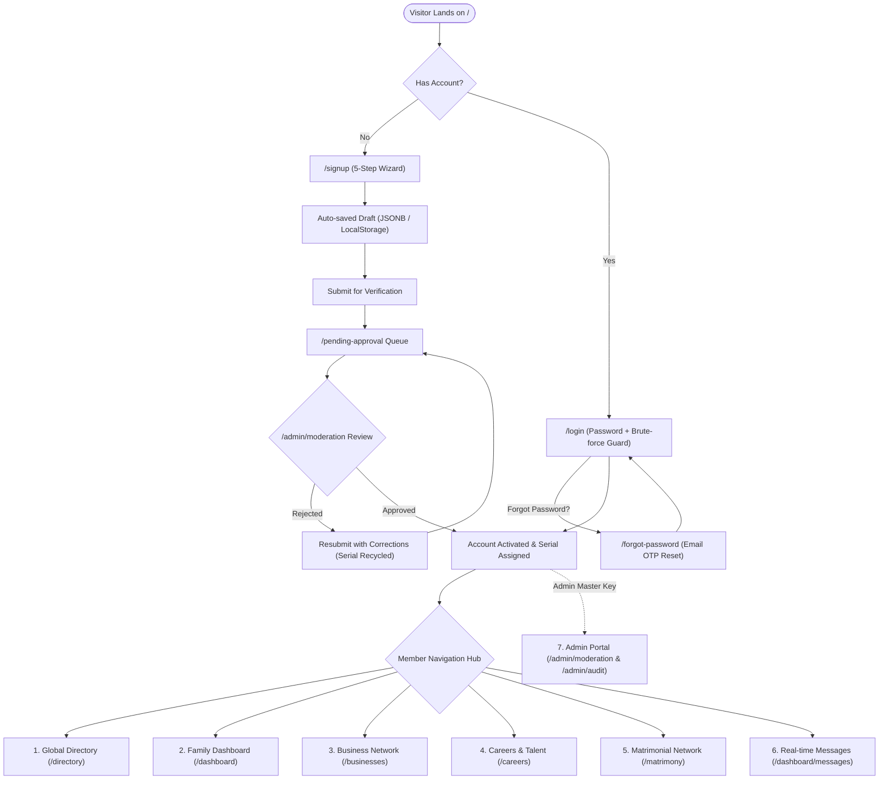
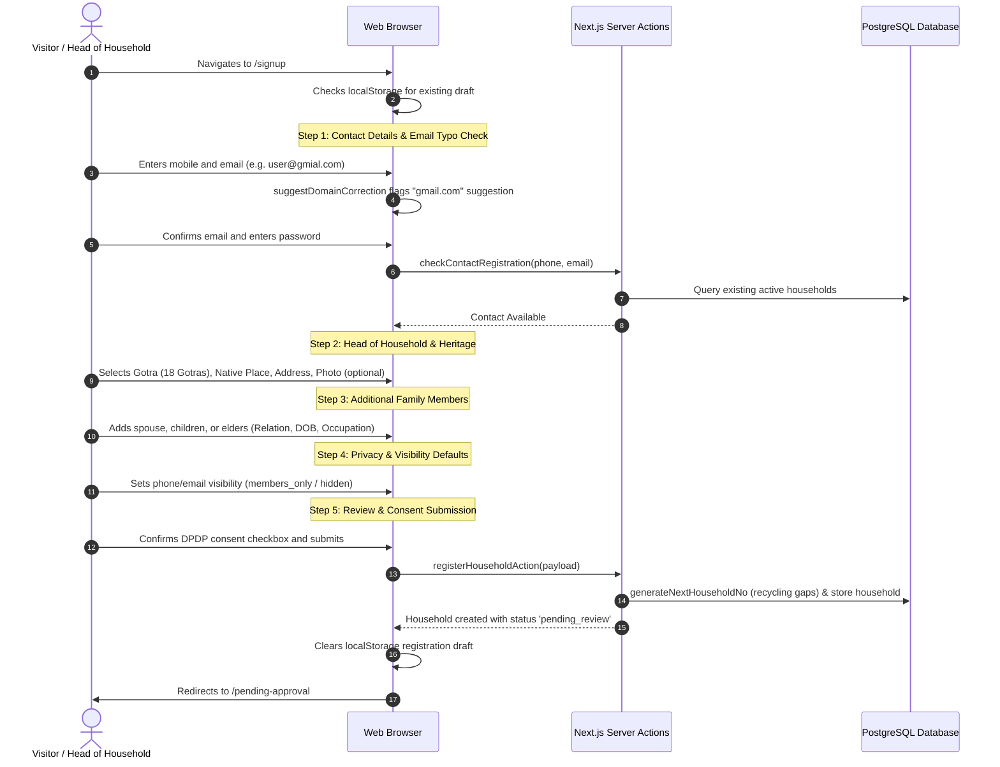
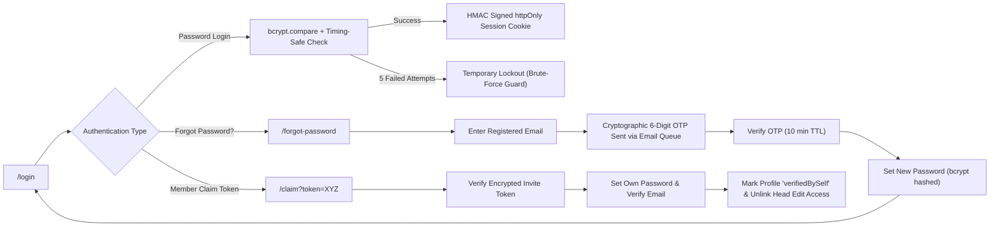
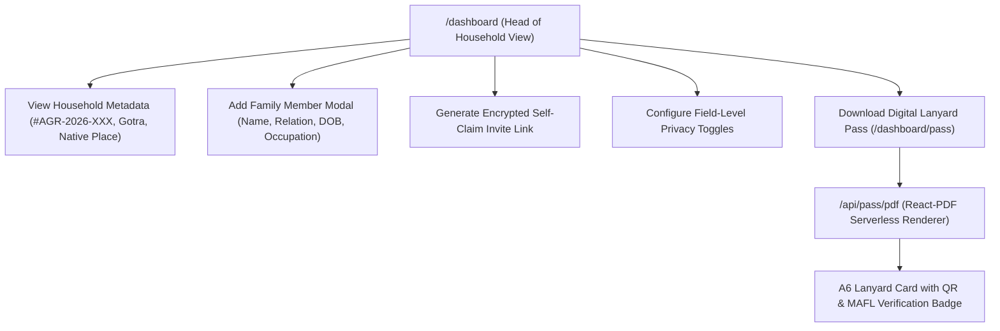
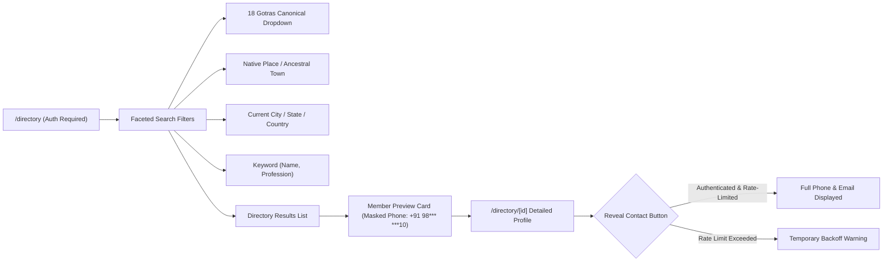
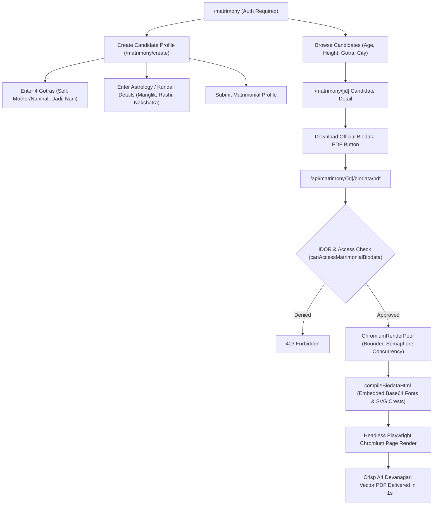
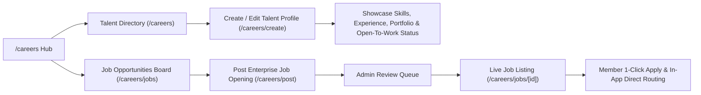
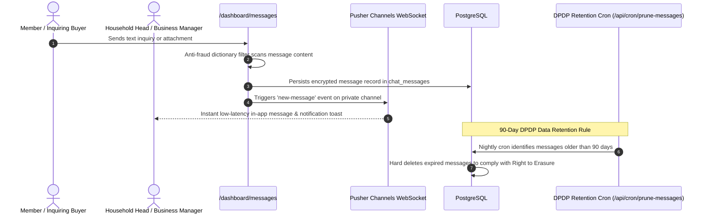
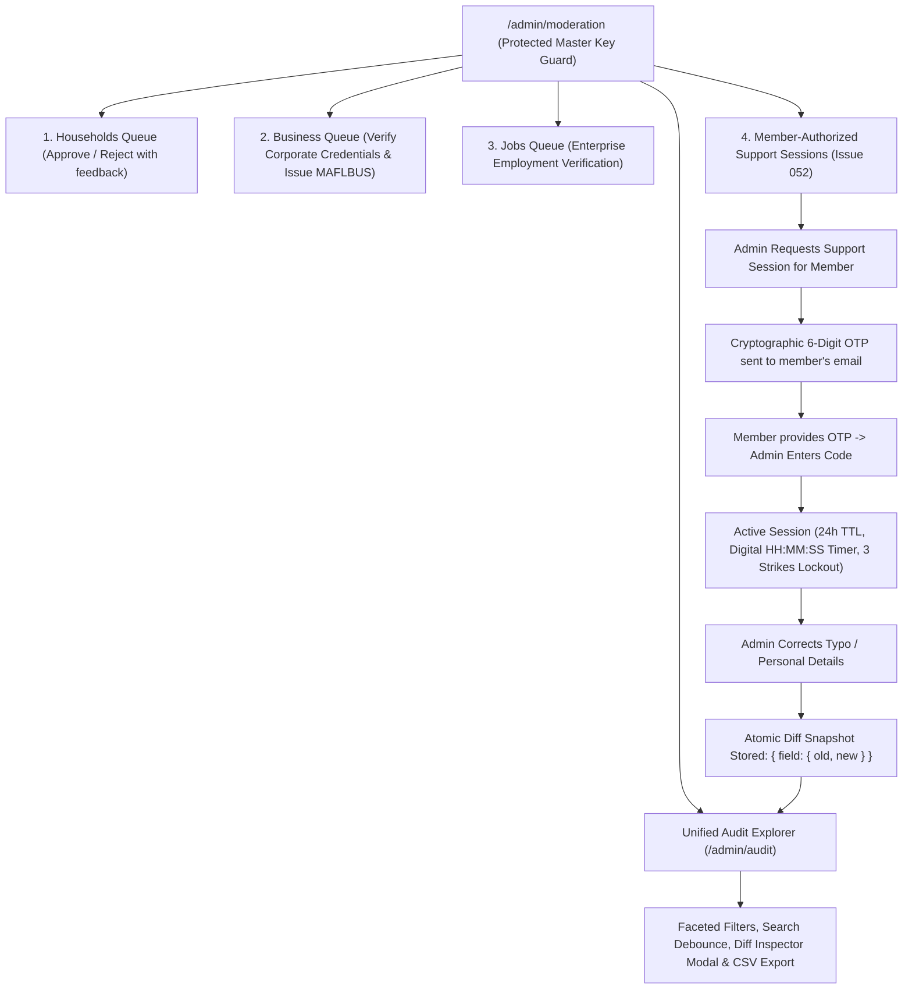

# Maharaja Agrasen Foundation Limited Singapore (MAFL)
# End-to-End User Flow & Navigation Architecture

> **One Community • One Platform • One Global Family | एक समाज • एक मंच • एक परिवार**  
> *Corporate Registration: UEN 202551557G (Singapore)*

---

## 🧭 System Role Matrix

The platform is designed around 6 distinct actor personas with granular, defense-in-depth permission boundaries:

| Actor Role | Entry Points | Key Capabilities & Boundary Limits |
|---|---|---|
| **Public Visitor (Guest)** | `/`, `/about`, `/guide`, `/help`, `/businesses`, `/careers/jobs` | Can browse public landing pages, search job board, view verified business cards. **Cannot** access directory search, member phone/email contacts, or matrimonial listings without logging in. |
| **Applicant (Pending Review)** | `/signup`, `/pending-approval` | Can submit a 5-step registration, auto-save drafts, and monitor verification status. Access to member-gated features remains locked until approved. |
| **Verified Member** | `/directory`, `/matrimony`, `/dashboard/messages`, `/settings` | Can search the directory, reveal contact details within rate limits, send 1-to-1 messages, post/apply for jobs, and download their digital lanyard pass. |
| **Head of Household** | `/dashboard`, `/dashboard/pass` | Manages the household family unit, adds family members, manages visibility toggles, and issues encrypted self-claim tokens to family members. |
| **Business Manager** | `/businesses/create`, `/businesses/[id]/edit` | Exclusive authority to edit enterprise details, pause/resume listings, initiate manager handover, and download the official ornate MAFL certificate. |
| **Platform Administrator** | `/admin/moderation`, `/admin/audit` | Approves/rejects households, businesses, and job listings; requests member-authorized OTP support sessions; inspects the immutable platform audit trail. |

---

## 🗺️ High-Level Navigation & Flow Diagram



---

## 🔄 Detailed User Journeys

### 1. Visitor Discovery & Registration Flow (`/signup`)



- **Serial Gap Reclamation**: If an application is rejected or cancelled, its temporary sequence is immediately reclaimed by `generateNextHouseholdNo` to eliminate permanent sequence drift.
- **Draft Recovery**: Changes are automatically synced to client `localStorage` and optionally to PostgreSQL JSONB drafts, ensuring users never lose registration progress upon accidental tab closures.

---

### 2. Authentication, Login & Password Recovery (`/login`, `/forgot-password`, `/claim`)



---

### 3. Family Dashboard & Member Management (`/dashboard`)



- **Claim Isolation**: Once an invited family member accepts their claim token at `/claim`, their record becomes `ownerLocked`. The Head of Household retains view permissions, while update rights transfer exclusively to the claimed individual.

---

### 4. Global Directory & Privacy-Gated Search (`/directory`)



- **DPDP Act Compliance**: Government IDs (Aadhaar, PAN, Passport) are strictly masked or redacted from public payloads at the database query layer (`privacy.ts`).

---

### 5. Verified Global Business Network (`/businesses`)

```mermaid
sequenceDiagram
    autonumber
    actor Mgr as Business Founder / Manager
    actor Admin as Platform Admin
    participant App as Web App (/businesses)
    participant DB as PostgreSQL
    participant PDF as React-PDF Engine

    Mgr->>App: Creates Enterprise Profile (/businesses/create)
    App->>DB: Stores business with status 'pending_review' and assign creator as current_manager
    Admin->>App: Reviews credentials (GSTIN / MSME / CIN) on /admin/moderation
    Admin->>DB: Approves Business & Assigns Permanent 'MAFLBUS-XXX-XXX-XXX'
    DB->>DB: Creates immutable record in business_certificate_issuances
    Admin-->>Mgr: Automated Approval Email with Certificate Attached

    Note over Mgr,App: Manager Operations (/businesses/[id]/edit)
    Mgr->>App: Downloads Official Certificate (/api/businesses/[id]/certificate)
    App->>PDF: Generates A4 Landscape Vector Certificate with Official Singapore Seal
    PDF-->>Mgr: Delivers PDF directly to manager browser
    
    Note over Mgr,App: Handover Lifecycle
    Mgr->>App: Initiates Handover to another verified member
    App->>DB: Creates pending handover invitation
    Note over App: Target member accepts handover
    DB->>DB: Updates current_manager; former manager access revoked immediately
```

---

### 6. Matrimonial Directory & Playwright Biodata Generation (`/matrimony`)



---

### 7. Careers & Enterprise Opportunities (`/careers`)



---

### 8. Real-Time Chat & Commercial Inquiries (`/dashboard/messages`)



---

### 9. Admin Moderation, Support Sessions & Unified Audit Trail (`/admin`)



---

## 🔒 Security & Defensive Guarantees

1. **Zero-Trust Support Sessions**: Platform administrators cannot unilaterally alter personal member records. A valid cryptographic challenge OTP sent directly to the member's email address is mandatory before access is temporarily unlocked.
2. **CWE-1236 Neutralization**: All platform CSV exports safely sanitize fields starting with `=`, `+`, `-`, `@`, `\t`, or `\r` to prevent spreadsheet formula execution exploits.
3. **IDOR Prevention**: All PDF download endpoints (`/api/pass/pdf`, `/api/businesses/[id]/certificate`, `/api/matrimony/[id]/biodata/pdf`) verify requester ownership, manager permissions, or explicit view access prior to invoking PDF rendering engines.
4. **Cold-Start Resilience**: The database layer bypasses redundant DDL checks on serverless cold boots, featuring a lazy auto-healing fallback that transparently self-migrates on runtime column/table misses.
